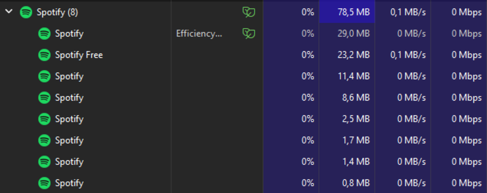
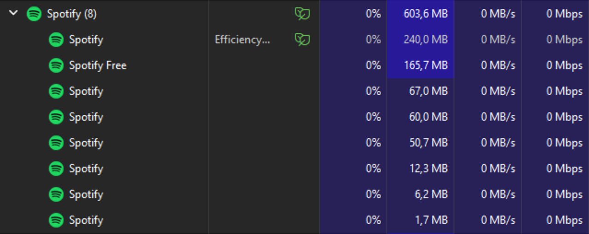

# Memory Sentry for Spotify Desktop

**Windows 10 and Windows 11 desktop editions only.** Memory Sentry is an experimental open-source companion for Spotify Desktop and Spicetify. When Spotify is minimized or hidden, it adaptively changes eligible child-process working-set ceilings, protects audio-service processes, and attempts to restore original limits when Spotify becomes visible.

> **1.0.0-rc.1 release candidate — experimental; use cautiously.** Working-set limits can cause extra page faults and delay Spotify's UI recovery. This project is not a substitute for Windows memory management and does not guarantee a specific RAM saving. Automated build and policy tests cannot replace the outstanding real-desktop Windows 10/11 audio, recovery, and restore-latency test matrix; do not treat this candidate as stable.

## The only supported installation method

1. Open the [official GitHub Releases page](https://github.com/yanlvl99/spicetify-memory-sentry/releases).
2. Download **Memory Sentry Setup** and its `.sha256` checksum from the same release.
3. Verify the checksum before running Setup. A checksum confirms file integrity, not the publisher's identity.
4. Run Setup as your normal Windows user, not as Administrator. It checks Windows and Spicetify before changing installed files; you do not have to close Spotify manually.
5. Setup installs the native companion, writes local settings/token, starts and health-checks the local API, then applies the Custom App through Spicetify. Spicetify may restart Spotify automatically.
6. When Spotify returns, select Memory Sentry in the sidebar. The helper is also registered to start at login for the current Windows user.

The Marketplace entry is for **discovery only** and points to the same official GitHub release. There is no separate Marketplace installer, Marketplace-specific build, or custom portable ZIP. GitHub's automatically generated source archive is for inspecting the source and is not an installation package.

The Inno Setup installer is per-user and does not require a machine-wide MSI installation. The executable is not code-signed, so Windows SmartScreen or antivirus may still show a reputation warning. Do not bypass security warnings blindly.

## Task Manager comparison images

| With Memory Sentry | Without Memory Sentry |
| --- | --- |
|  |  |

The sharpened SVG previews use only the supplied COM.png and SEM.png captures; the original PNG files remain unchanged. These illustrations are not a controlled benchmark: they do not establish repeatable performance or promise the same RAM reduction on another PC.

## What the adaptive policy does

The current policy keeps an individual working-set ceiling for each eligible Spotify process:

- Starting ceilings: main process 36 MB; GPU and renderer 28 MB; utility/helper 24 MB; crash handler 16 MB.
- If one process uses at least 10% of one logical processor for six seconds, its ceiling can increase by 8 MB.
- If CPU remains at or below 3% and the working set stays at least 6 MB below its ceiling for ten seconds, the ceiling can decrease by 4 MB.
- Changes have an eight-second cooldown. The global policy range is 12–64 MB, with a 24 MB floor for the main process and lower floors for background processes.
- Audio-service processes are excluded. The policy runs after the configured hide/minimize delay. The helper saves original Windows limits before changing them and attempts to restore them when Spotify becomes visible.

CPU is estimated from process-time deltas and expressed as a percentage of one logical processor, capped at 100% per process. High CPU is only a heuristic; it does not prove that a process needs more memory. Working-set MB is resident RAM, not private committed memory, and summed working sets can double-count shared pages.

## Requirements

- Windows 10 or Windows 11 desktop edition, x64.
- Spotify Desktop and Spicetify CLI installed for the same Windows user.
- The official setup program contains the Rust native companion. A global Node.js installation is not required for new installations.
- When migrating a legacy Node.js installation with an outstanding recovery file, setup may request Node.js 22+ temporarily to run the old helper's restore command. If legacy recovery cannot be verified, setup stops and preserves the backup instead of deleting it.

macOS, Linux, Windows 7/8/8.1, Windows Server and ARM64 Windows are not supported by this release.

## Installed components and safety

- Custom App: %APPDATA%\spicetify\CustomApps\SpicetifyMemorySentry
- Native companion, settings and recovery state: %LOCALAPPDATA%\SpicetifyMemorySentry
- User startup registration: HKCU\Software\Microsoft\Windows\CurrentVersion\Run
- Logs: %LOCALAPPDATA%\MemorySentry\logs after uninstall

The companion runs as a separate per-user process under the current Windows user, exposes its dashboard API only on 127.0.0.1, requires a random per-install token, validates the Spotify HTTPS origin and loopback Host header, and does not upload telemetry. The installer launches it automatically and verifies the local status API. Early startup failures are recorded in %LOCALAPPDATA%\\SpicetifyMemorySentry\\logs\\startup.log. Dashboard failures now include the underlying local API error, and uninstall attempts safe recovery without requiring Spotify to be closed. It checks the process creation timestamp before changing or restoring limits, persists recovery data before applying a cap, and stops upgrade/uninstall if a limit cannot be safely restored.

## Upgrade and uninstall

Setup and uninstall do not require you to close Spotify manually; Spicetify apply manages its own refresh/restart. Setup attempts to restore the old helper's limits before replacing it and preserves recovery data if restoration cannot be confirmed. Windows Settings → Apps → Installed apps → Memory Sentry → Uninstall runs a pre-uninstall recovery check. If recovery fails or recovery records exist while the executable is missing, uninstallation stops and preserves data. Do not manually delete recovery files to bypass an error.

## Build from source

Install the stable Rust toolchain and Inno Setup 6. From the repository root, run cargo test with manifest path native/rust/Cargo.toml and --locked, then cargo build --release for target x86_64-pc-windows-msvc. A complete setup also needs the Custom App and docs staged as described in installer/inno/MemorySentry.iss. GitHub Actions builds the single supported Setup EXE and its SHA-256 checksum. GitHub's automatically generated source archive is for source review, not an alternate installer. CI compilation is not the same as an actual Spotify/audio/restore test on a Windows 10/11 desktop.

## Open source, license and antivirus notices

Source and release packaging are public under GPL-3.0. The helper emits no remote telemetry and does not read playlists, track names, listening history or Spotify credentials. The installer does not disable Defender, SmartScreen, the firewall or execution-policy controls.

**No unsigned release can guarantee zero SmartScreen or antivirus warnings.** A new Rust executable can still trigger warnings due to publisher/file reputation. Do not bypass security warnings blindly. Verify the download source and SHA-256, inspect the open source, and report suspected false positives with the specific file hash.

See PRIVACY.md, SECURITY.md, docs/INSTALLATION.md, docs/TROUBLESHOOTING.md and docs/RUST-MIGRATION.md.
